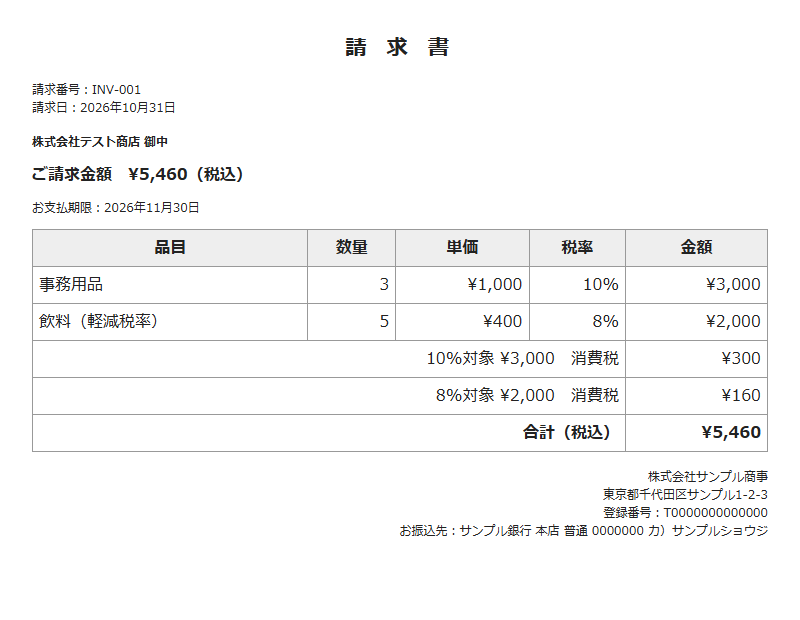

# 一覧表から請求書と送付状をまとめて作るGASデモ

スプレッドシートの一覧表から、請求書と送付状のPDFをまとめて作るスクリプトです。会社名・金額はすべて架空のデータで、動作を確認したデモです。



## 何をするか

- 「請求一覧」シートで、作りたい行の「対象」にチェックを入れる
- メニュー「請求書」→「チェックした行をまとめて作成」を押す
- 同じ請求番号の行が1通の請求書になり、請求書と送付状のPDFがDriveの「請求書PDF」フォルダに出力される

一覧表の列：`対象 / 請求番号 / 宛先 / 請求日 / 支払期限 / 品目 / 数量 / 単価 / 税率`（1行＝1品目）

## 消費税の扱い

10%と8%が混在していても、税率ごとに合計してから、端数を切り捨てます（1請求書につき、税率ごとに1回）。請求書には、税率ごとの対象額と消費税を分けて表示します。

端数の処理（切り捨て・切り上げ・四捨五入）や、請求書に必要な記載事項は、お客様の運用に合わせて調整します。記載内容の正しさは、お客様側でご確認ください。

## 動作確認

`Code.gs` をそのまま読み込み、GASの `SpreadsheetApp`・`DriveApp`・`Utilities` だけを偽物に差し替えて、Nodeで6件のテストを実行しています。

```bash
node --test test.mjs
```

確認していること：チェックした行だけが対象になること、請求番号ごとのまとめ、10%と8%混在時の集計、端数の切り捨て、HTMLの記号のエスケープ、請求書と送付状のファイルが請求書の数だけ作られること。

`samples/` の画像は、`Code.gs` が実際に出力したHTMLをブラウザで表示したものです。

注意：実際のGoogleアカウント上での動作と、PDFの見た目（フォントなど）は、このデモでは確認していません。納品の際は、お客様の一覧表と書類の見本で、サンプルを作って確認します。

## 使い方（お客様の環境で動かす場合）

1. 一覧表のスプレッドシートに「請求一覧」シートを作り、上の列の並びで入力する
2. 拡張機能 → Apps Script に `Code.gs` を貼り付けて保存
3. `ISSUER`（発行元の名前・住所・登録番号・振込先）を、お客様の情報に書き換える
4. シートを開き直すと、メニュー「請求書」が出る。初回だけ、Googleの許可画面で、ご自身で承認する（パスワードは不要です）
